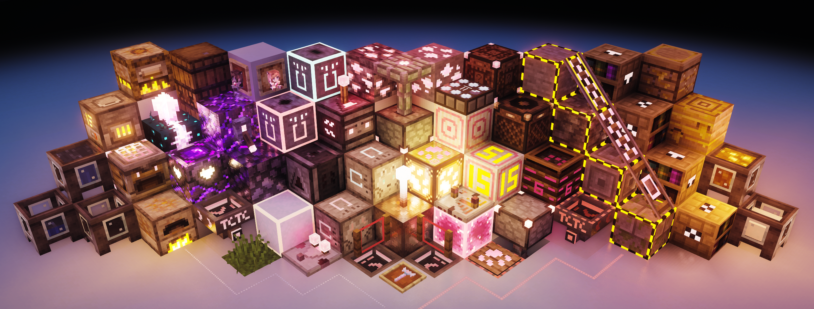

<h1 align = "center">樱喵红显</h1>
<h3 align = "center">TCTC Cherry</h3>

[English](README.md) | **简体中文**

## 介绍

本纹理包为红石显示资源包，含有部分非红显内容。

目前兼容的游戏版本：1.16-26.2

### 主要修改内容

- 红石元件主颜色为樱粉色
- 自发光贴图：
    - 标准一：LabPBR标准，推荐配合 [Complementary r5.3+](https://modrinth.com/shader/complementary-reimagined/version/latest) 光影（+[Euphoria Patches 1.4.1+](https://www.euphoriapatches.com/how-to-install/)），将集成PBR+自发光模式设置为 labPBR > IPBR+;
    - 标准二：OptiFine 使用的 _e 纹理（仅在 1.16-24w37a 可用）
    - 标准三：原版 light_emission 模型字段（在 24w37a 后可用，因功能限制，制作繁琐等原因，目前只完成了一部分方块）

## 模组需求

发光纹理使用含 LabPBR 支持的光影，在不开启光影的情况下需要 [OptiFine](https://www.optifine.net/downloads) 或 [MoreMcmeta](https://modrinth.com/mod/moremcmeta) + [MoreMcmeta Emissive Textures](https://modrinth.com/mod/moremcmeta-emissive) 模组.

## 许可协议

[CC BY-NC-SA 4.0](https://creativecommons.org/licenses/by-nc-sa/4.0/deed.zh)

## 致谢

- Xekr：系列材质教程让我受益匪浅，也参考了不少他的红显资源包创作方法。Xekr：[BiliBili](https://space.bilibili.com/5930630)
- Hendrix_Shen: 模组支持
- Capt Tastu：感谢他的创意授权
- 药水棒冰：感谢他的创意授权
- 南烛：材质创作指导
- 火昱Huoyu：选择框改色原版着色器实现授权
- GeForceLegend：许多指导和协助定位解决问题
- wellcoming：修复PBR纹理问题
